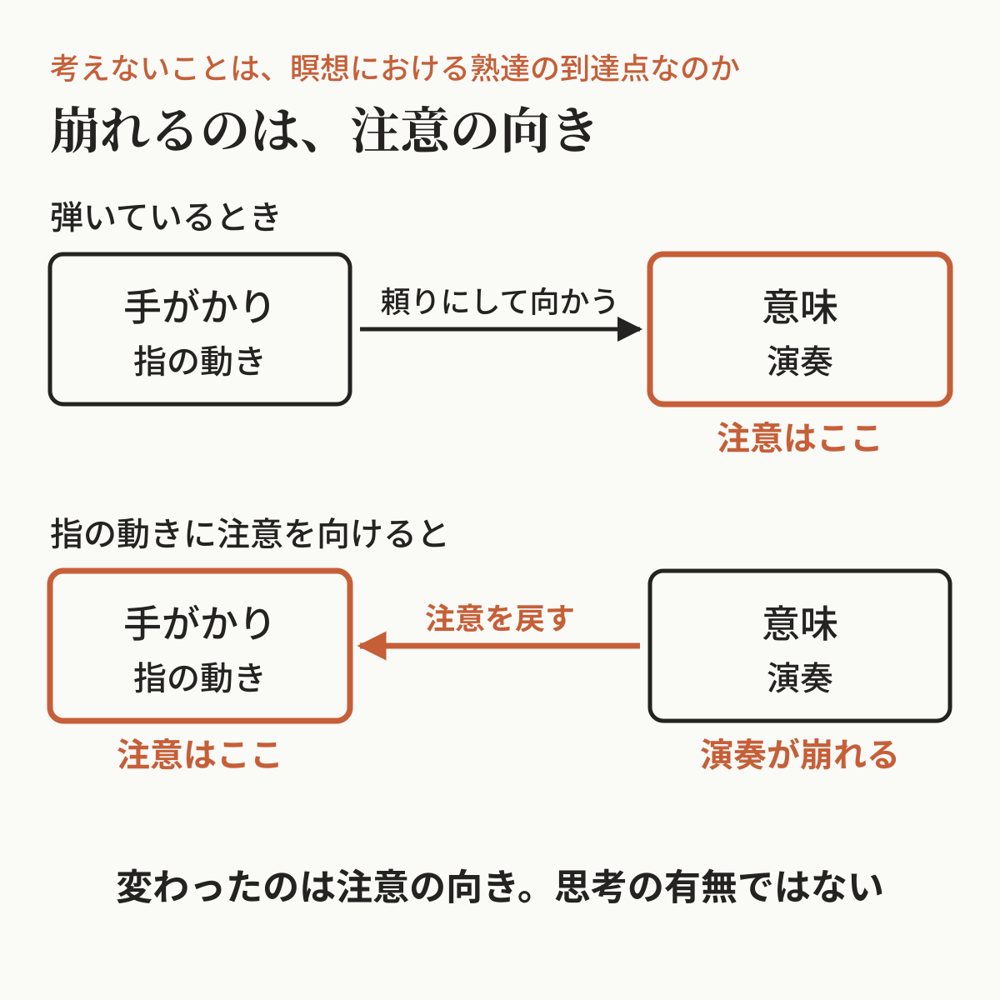
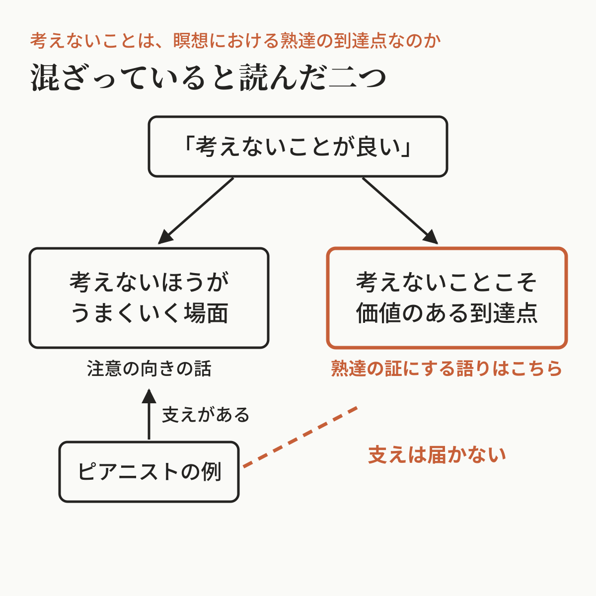
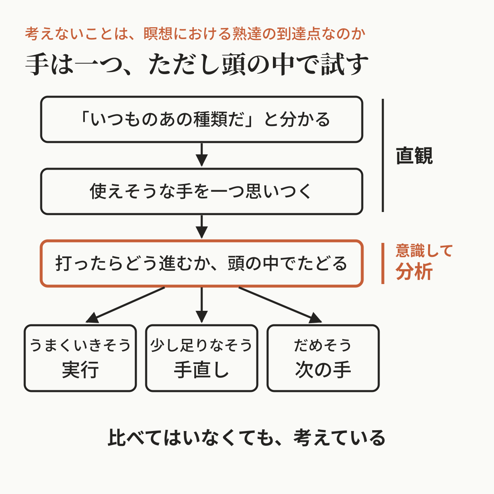

# 考えないことは、瞑想における熟達の到達点なのか

## 思考が止まる至福、という語り

瞑想について書かれたものを読んでいると、ときどきこういう語りに出会います。ある時を境に、日常の中で思考がほとんど湧かなくなった。身近な人が小さなことで悩んでいても、それは思考が作り出した幻なので、穏やかに眺めていられる。考えすぎる現代人にとって、瞑想の行き着く先は、思考という牢獄から解放される至福なのだ、と。

私はこの種の語りを見るたびに、それは何か違う、と思ってきました。かなり前からある違和感です。

この語りが救いになる人もいるのかもしれません。仕事や人間関係に疲れて瞑想を始める人は多く、そういう人はたいてい考えすぎているように思います。考えを止めてよい、と言われて楽になるなら、一時的な処方箋としてはいいと思います。また、考え込まずに直観で日常に応じられるようになることを瞑想の熟達と呼ぶのなら、一定は理解できなくもありません。

引っかかるのは、思考が湧かないことを熟達の証にしているところです。ここには、私はどうしても頷けません。文字どおり思考が湧かないのなら、その人は、初めての手続きに戸惑ったときや、予定が急に崩れたとき、どうやって次の手を決めているのでしょうか。

これは言いがかりではありません。瞑想の界隈を離れれば、誰でも当然のように持つ疑問のはずです。

けれども、その語りの中に、この問いへの答えは見当たりません。それどころか、そういう疑問が湧くこと自体がまだ熟達していないことの表れだ、という理屈に回収されてしまいます。これでは外から問いようがなくなってしまうのが、私には残念です。

普通に社会生活を送るなら、考えることをやめるわけにはいきません。

思考がないことが熟達であり、人間としての至福なのだ。この見方に、私は個人的にはあまり同意できません。

## 暗黙知を学んでいて、違和感の形が変わった

このところ、私は暗黙知と熟達の理論を学んでいます。この文章で使うのは、そのうちポランニーの暗黙知、ドレイファス兄弟の技能習得の五段階とそれへの批判、クラインの現場の意思決定の研究です。

私は上達のうえで、暗黙知をかなり重く見ています。そして暗黙知の理論には、ドレイファス兄弟の五段階のように、熟達者は考えずにできる、という像を描くものがあります。そうだとすると、私の違和感は、自分が大事にしている考えと食い違っているのかもしれません。

この文章は、学んだ理論に自分の違和感を当ててみた記録です。先に結論を言うと、食い違いはありませんでした。暗黙知を重く見ることと、考えないことを到達点に置くことは、別のことでした。学んだ理論は、暗黙知を重く見ることは支えますが、考えないことを到達点に置くことは支えません。

以下、気づいた順に書きます。

## 崩れるのは、注意の向きを変えたとき

最初に引っかかったのは、マイケル・ポランニーの暗黙知の議論です。ポランニーは1966年の『暗黙知の次元』で、私たちは語れる以上のことを知っている、という事実から話を始めました。知り合いの顔は一目で分かるのに、どこで分かったかは言えません。

ポランニーによれば、こういう知には二つの気づき方が組み合わさっています。手がかりの側には、それを頼りに先へ向かう形で気づいています。意味の側には、注意を向けて気づいています。

杖で道を探る人は、手のひらに来る衝撃を頼りに、杖の先にある段差を感じ取っています。手のひらの衝撃は、そのとき注意の的ではありません。

そしてポランニーは、手がかりから意味へ向かうこの関係は、一度できると長続きするが、注意を手がかりの側へ引き戻すとひどく損なわれる、と書きます。ピアニストが弾いている最中に自分の指の動きに注意を向けると、演奏が崩れる、という例です。

これを学んだとき、まさに瞑想が気にしていることだ、と思いました。禅などでよく聞く話のような気がします。

ただ、よく見ると、ここで言われているのは思考があるかないかではありません。注意をどちらへ向けるかです。演奏が崩れたのは、意味へ向かっていた注意を、指という手がかりの側へ戻したからです。

瞑想のなかには、逆にあえて手がかりの側へ注意を向けるやり方もあります。歩く感覚を一歩ずつ区切って見る、音を意味づけずに音として聞く、といったものです。そうすると、ふだん一瞬でまとまっている経験が、どう組み立てられているかが見えてきます。

ここで瞑想が扱っているのも、注意の向け方です。思考があるかないかではありません。

ポランニーは、言葉や式にした知も、暗黙の知に支えられて初めて働く、とも書いています。たとえば地図は、言葉や記号にした知の典型です。けれども地図を使うには、地図の上の記号と目の前の道を結びつける見分けが要ります。その見分けは、地図のどこにも書かれていません。

暗黙知は、言葉や考えに取って代わるものではなく、言葉や考えを下で支えているものでした。だから暗黙知を重く見ることは、考えることを手放すこととは結びつきません。

## 熟達者は、考えずに動いているのか

暗黙知の理論のうち、熟達者は考えずにできる、という像をいちばんはっきり描いたのは、ヒューバートとスチュアートのドレイファス兄弟です。二人は1986年の『Mind over Machine』で、大人が技能を身につける道筋を、初心者、上級の初心者、一人前、習熟者、熟達者の五段階に分けました。

初心者は、場面から切り離された規則に従います。「玉ねぎは中火で3分炒める」。経験を積むと、「透き通って甘い匂いがしてきたら」のような、何度か見て覚えるしかない様子を使えるようになります。やがて何が大事かが選ばなくても見えるようになり、最後の熟達者の段では、どう応じるかまで見えて、為すべきことがただ為される、と二人は書きます。

この最後の段だけを見ると、考えないことの理想像に見えます。実際、この像には批判があります。

フェルナン・ゴベとフィリップ・チャシーは2009年の論文で、熟達者はほとんど考えずに動ける、という描き方に疑いを向けました。ドレイファス兄弟は、チェスの国際マスターに数の足し算を続けさせながら早指しをさせても互角以上に指せた、という試しを根拠に挙げていました。

ゴベとチャシーは、この試しは細部が書かれておらず評価できないとしたうえで、統制した実験では、頭の働きをふさぐ課題を同時にさせると指し手の質がはっきり落ちたこと、考える時間を減らすと腕前が下がることを挙げました。チェスの熟達者は、ふつうの対局でも、見えた手をもとに数手先を読み、また盤を見て、また読む、という行き来をしている、というのが二人の描き方です。

ゴベは2018年にも同じ向きの批判を論文に書き、これにはスチュアート・ドレイファスとスコット・ルースが論評で応じました。兄弟は、ふつうでない場面では熟達者も熟慮すると書いていた、という反論です。ゴベはさらに、兄弟の記述そのものが食い違っていると返しています。少なくともこの2018年の応酬の時点で、熟達者の中でどこまで考えが働いているかは決着していませんでした。

慣れない場面では熟達者も考える、という点は、ドレイファス兄弟もゴベとチャシーも認めています。直観が本物の働きだという点も、ゴベとチャシーは認めています。

割れているのは、慣れた場面での熟達者のふだんの振る舞いの中に、先を読む働きがどれだけ残っているかです。ドレイファス兄弟の描き方では、場面が見えたらそのまま手が動く一本の線になります。ゴベとチャシーの描き方では、見て、少し読み、また見る、細かいジグザグの線になります。

ただ、この論争で「考える」と呼ばれているのは、主に選択肢を並べて比べることや、数手先を読むことです。

私の内観では、考えはもっと細かく、ほとんど途切れずに続いています。私の場合、瞑想をして内観を続けるほど、考えていない瞬間がほとんどないことが分かってきました。そこには、言葉になるつぶやきもあれば、言葉にならない見通しもあり、注意がただ動くこともあります。

論争はこれらを分けていません。私の内観は、ジグザグの線をさらに細かくした側にあるように見えます。

## もがいた末に来るもの

五段階を読み直すと、伸びる力が置かれているのは、最後の熟達者の段ではなく、真ん中の一人前の段でした。

以下は、スチュアート・ドレイファスが2004年に五段階をまとめ直した論文によります。見分けられることが多すぎて手が回らなくなった人は、何を大事にするかを自分で選びます。選び方を教える規則はないので、選んだ見方が外れれば、それは自分の失敗です。

悔しさも含めて、その成功と失敗を自分のこととして引き受けた経験が積み重なって、次の段の見え方が育つ、と書かれています。関わることを避けて規則の安全に逃げる人は伸びが止まりやすい、という指摘もあります。

考え抜いてもがいた末にブレークスルーが来る、という型もあると私は思っています。いつもそうなるとまでは言いませんが、考えないことの理想像に近く見える理論でさえ、考えずに動ける状態の手前に、もがく段を置いていました。

ここまで読んで、自分が同意できなかったものは、こういう形をしているのかもしれない、と思うようになりました。

「考えないことが良い」という主張には、二つのものが混ざっています。

一つは、考えないほうがうまくいく、と見える場面の話です。ポランニーのピアニストの例のように、動いている最中に手がかりへ注意を戻すと崩れる、という注意の向きの話としてなら、これには支えがあります。

もう一つは、考えないことこそが価値のある到達点だ、という主張です。私は上達において暗黙知を重視しますが、そうなることだけが価値のあることだという主張には、同意できません。

思考が湧かないことを熟達の証にする語りは、この、考えないことこそが価値のある到達点だ、という主張です。そして、ピアニストの例が与える支えも、この主張には届きません。支えがあるのは、動いている最中にどこへ注意を向けるかという狭い場面の話で、日常のどこでも思考が湧かないことではないからです。

## 手は一つ、ただし頭の中で試す

論争の「考える」が、選択肢を並べて比べることだとすると、比べずに決める熟達者は考えていないのでしょうか。ここで、ゲイリー・クラインの研究が手がかりになりました。

クラインたちは1980年代半ばに、経験の長い消防隊の隊長たちから、火事の現場で難しい判断をした場面を聞き取りました。

燃えている建物に着いた隊長は、どう消すかを決めなければなりません。たとえば、中に入って火元を叩くか、外から水をかけて延焼を防ぐか、まず逃げ遅れた人の救助に回るか、といった選択です。

研究者たちは、隊長がこうした手をいくつか並べて比べ、いちばんよいものを選んでいるだろうと予想していました。ところが隊長たちは、ふつう一つの手しか考えていませんでした。

これだけ聞くと、熟達者は考えずに直観で動く、という話に見えます。けれどもクラインが描いた決め方には、もう一つの段があります。

隊長は、目の前の火事を見て「いつものあの種類だ」と分かると、使えそうな手を一つ思いつきます。そして、その手を打ったら火事がどう進むかを、頭の中で順にたどってみます。うまくいきそうならそのまま実行し、少し足りなければ手直しし、だめなら次の手を考えます。

クラインはこの決め方を RPD（Recognition-Primed Decision）と名づけました。「あの種類だ」と分かって手を思いつくところは直観で、頭の中で試すところは意識して行う分析です。比べてはいなくても、考えてはいたわけです。

そして、最初に浮かぶ手が当てになるのは、その種類の場面の経験があるからです。経験のない場面では外れます。私はクラインの主張を、経験と同じ種類の場面でうまくいく、という主張として読みました。考えないことに価値がある、という主張ではありません。

## 考えないことを、到達点に置かない

理論を学ぶ前、私の違和感は「何か違う」というところで止まっていました。いまは、どこで引っかかっていたのかが、少し見えてきた気がします。考えないほうがうまくいく場面がある、という注意の話には、理論の支えがあります。

私が同意できないのは、その話が、考えないことそのものに価値がある、という話へ滑るところでした。

暗黙知はこれからも重く見ますが、考えないことを到達点には置きません。思考がないことが至福だ、というナイーブな見方で本当にいいのか、と問い続けます。
## 出典・参考文献

**瞑想を始める動機**
- 「Motivation for Meditation and Its Association with Meditation Practice in a National Sample of Internet Users」2022年　https://pmc.ncbi.nlm.nih.gov/articles/PMC9728621/

**暗黙知（ポランニー）**
- Michael Polanyi『The Tacit Dimension』Doubleday、1966年
- Michael Polanyi「The Logic of Tacit Inference」Philosophy 41(155)、1966年

**技能習得の五段階と、その批判**
- Hubert L. Dreyfus、Stuart E. Dreyfus『Mind over Machine』Free Press、1986年
- Stuart E. Dreyfus「The Five-Stage Model of Adult Skill Acquisition」Bulletin of Science, Technology & Society 24(3)、177–181、2004年　https://doi.org/10.1177/0270467604264992
- Fernand Gobet、Philippe Chassy「Expertise and Intuition: A Tale of Three Theories」Minds and Machines 19(2)、151–180、2009年　https://doi.org/10.1007/s11023-008-9131-5
- Fernand Gobet「The Future of Expertise: The Need for a Multidisciplinary Approach」Journal of Expertise 1(2)、107–113、2018年
- Stuart Dreyfus、B. Scot Rousse「Commentary on Fernand Gobet's (2018) "The Future of Expertise"」Journal of Expertise 1(3)、181–183、2018年　https://www.journalofexpertise.org/articles/JoE_2018_1_3_DreyfusRousse_earlyview.pdf
- Fernand Gobet「Reply to Dreyfus and Rousse (2018)」Journal of Expertise 1(3)、184–186、2018年　https://www.journalofexpertise.org/articles/volume1_issue3/JoE_2018_1_3_Gobet.pdf

**現場の意思決定（クライン）**
- Gary A. Klein、Roberta Calderwood、Anne Clinton-Cirocco「Rapid Decision Making on the Fire Ground」Proceedings of the Human Factors Society Annual Meeting 30(6)、576–580、1986年
- Gary Klein『Sources of Power: How People Make Decisions』MIT Press、1998年
- Gary Klein「The RPD Model」https://www.gary-klein.com/rpd

---

**この記事の書き方**: 本文は Claude（Claude Code）が書きました。素材は、このところ私が AI を相手に受けた暗黙知と熟達の講義の記録と、この記事のために Claude が私に行ったインタビューです。インタビューの答えは材料で、文章は Claude が組み立てました。どの違和感を起点にするかと、学んだ理論のどれを採りどれを外すか（ブルデューの理論などは外しました）は私が決めました。見出し画像は Codex（gpt-image-2）で生成し、描くものと構図は私が選びました。公開前に私が全文を読み、内容の責任は私が負います。
