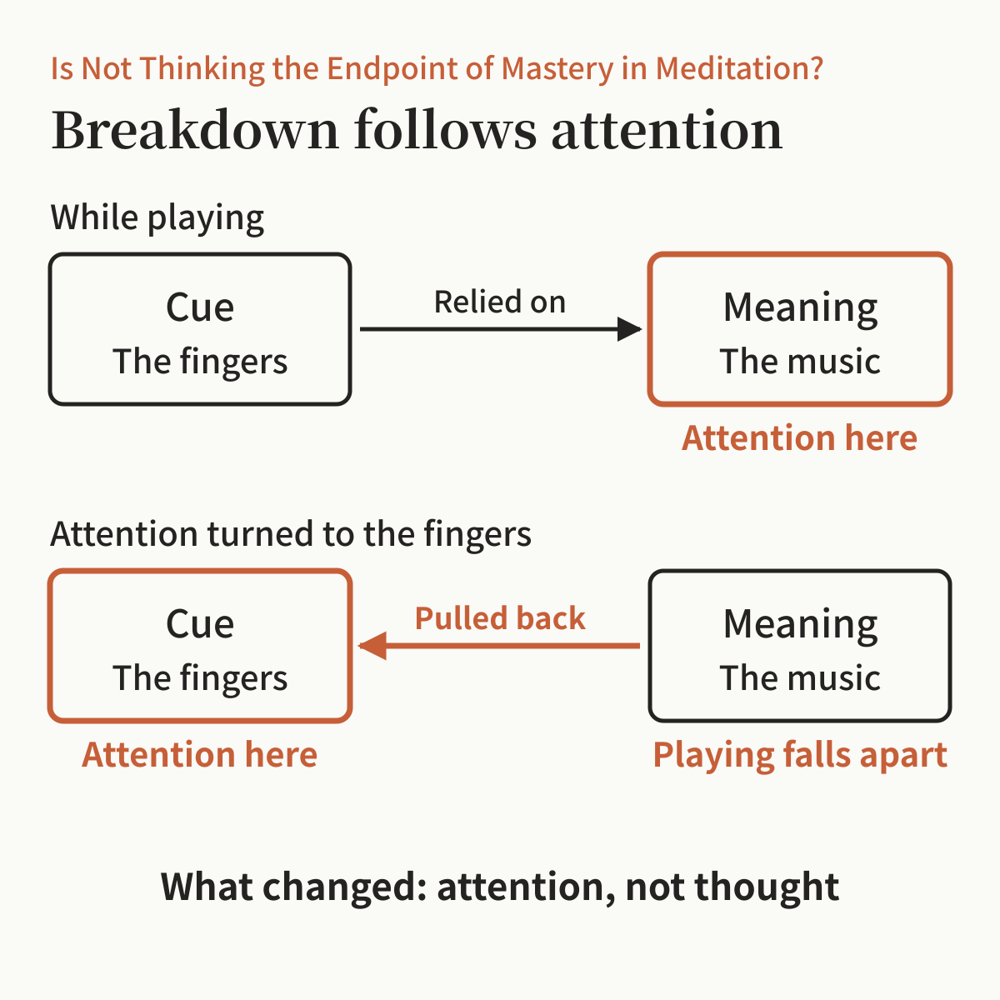
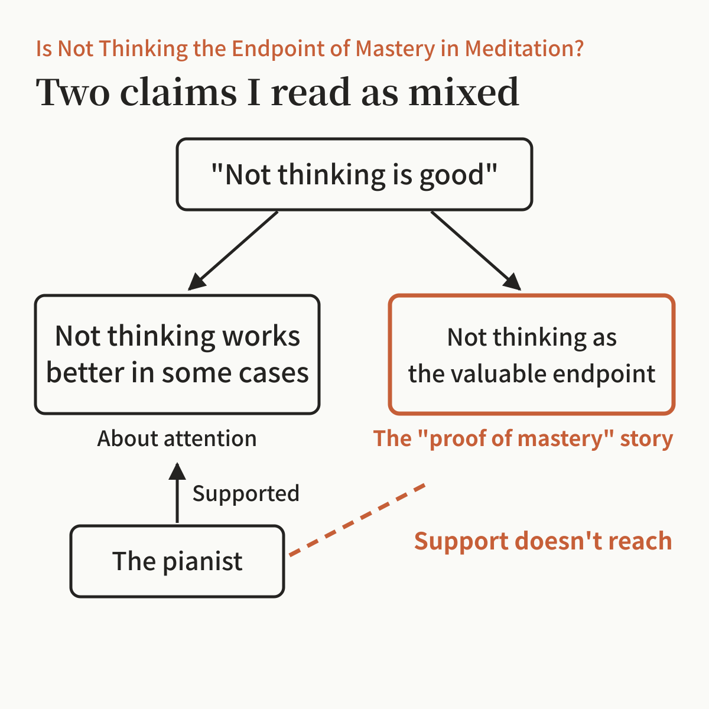
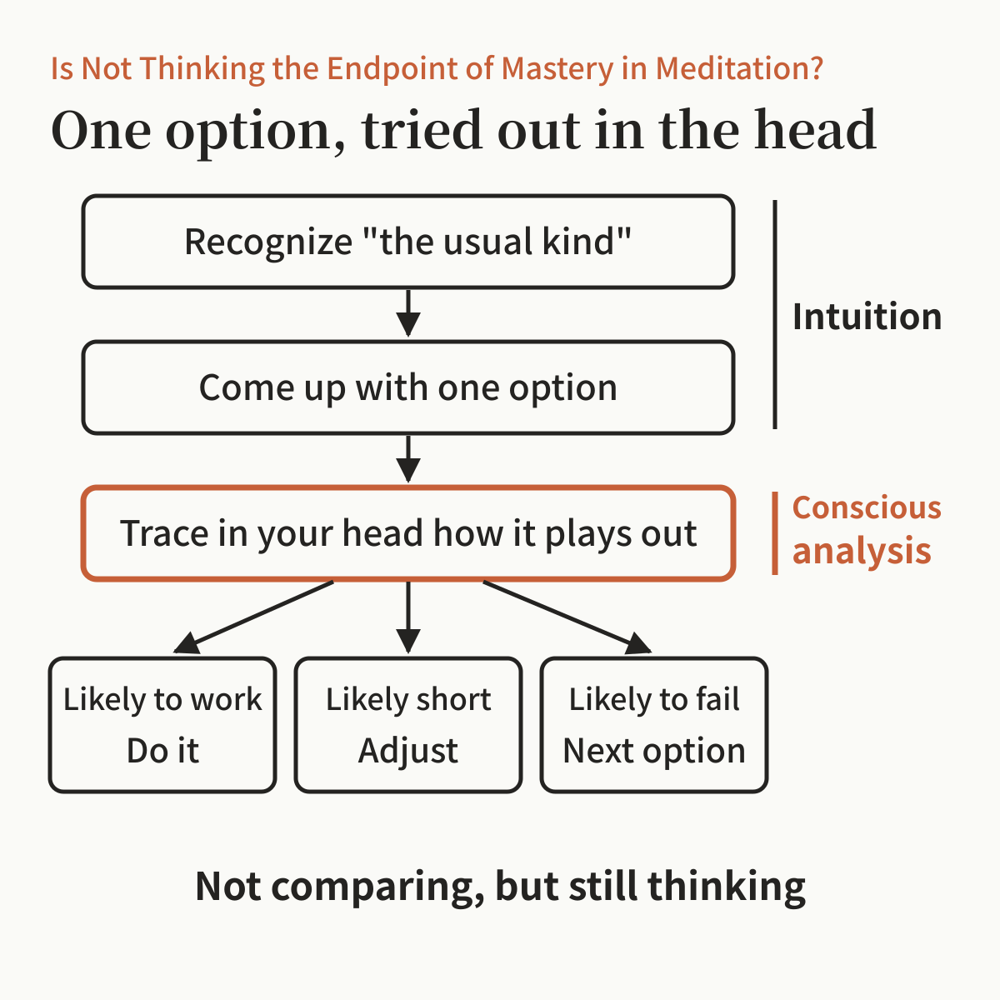

# Is Not Thinking the Endpoint of Mastery in Meditation?

> I put a lot of weight on tacit knowledge in getting better at things. Holding my unease up against theories of tacit knowledge and expertise, I found they support that, but not the idea that a mind where thoughts no longer arise is where mastery ends up.

## The story of a bliss where thinking stops

When I read what people write about meditation, I sometimes come across a story like this. At some point, thoughts all but stopped arising in daily life. When someone close is troubled over something small, that is an illusion made by thought, so one can watch it calmly. For modern people who think too much, where meditation leads is the bliss of being freed from the prison of thought.

Whenever I have come across this kind of story, I have thought: something is off. It is an unease I have had for a long time.

Perhaps this story is a relief for some people. Many people start meditating because they are worn out by work or relationships, and such people, I think, are usually thinking too much. If being told it is fine to stop thinking makes them feel better, I think that is fine as a temporary prescription. And if what is called mastery in meditation is being able to respond to daily life intuitively, without getting lost in thought, I can understand that to a degree.

What catches me is that the story makes the absence of arising thought the proof of mastery. Here I simply cannot nod along. If thoughts literally do not arise, how does that person decide what to do next when an unfamiliar procedure puzzles them, or when their plans suddenly fall apart? This is not nitpicking. Outside meditation circles, it is a question anyone would naturally have. Yet I find no answer to it within the story. Worse, the very fact that such a question arises gets folded back into the logic as a sign that you have not yet reached mastery. That leaves no way to question it from outside, and I find that a pity. If you live an ordinary social life, you cannot stop thinking.

Having no thought is mastery, and the bliss of being human. Personally, I can't really agree with this view.

## Studying tacit knowledge changed the shape of my unease

Lately I have been studying theories of tacit knowledge and expertise. The ones I use in this essay are Polanyi's account of tacit knowledge, the Dreyfus brothers' five stages of skill acquisition and the criticism of it, and Klein's research on decision-making in the field.

In getting better at things, I put a lot of weight on tacit knowledge. And some theories of tacit knowledge, like the Dreyfus brothers' five stages, paint a picture in which experts can act without thinking. If so, my unease may be at odds with an idea I hold dear.

This essay is a record of holding my unease up against the theories I studied. To give the conclusion first: there was no conflict. Putting weight on tacit knowledge and making not thinking the endpoint turned out to be two different things. The theories I studied support the first, but not the second. What follows is in the order I noticed things.

## It falls apart when attention changes direction

The first thing that caught me was Michael Polanyi's account of tacit knowledge. In *The Tacit Dimension* (1966), Polanyi started from the fact that we can know more than we can tell. You recognize an acquaintance's face at a glance, yet you cannot say what you recognized it by.

According to Polanyi, knowledge like this combines two ways of being aware. We are aware of the cues by relying on them to move toward something beyond them. We are aware of the meaning by attending to it. A person feeling their way with a cane senses the step at the tip of the cane by relying on the jolts that reach their palm. At that moment, the jolts in the palm are not what their attention is on.

And Polanyi writes that this relation, from cues to meaning, lasts once it is established, but is badly damaged when attention is pulled back to the cues. His example is a pianist: if the pianist turns their attention to the movement of their own fingers in the middle of playing, the performance falls apart.

When I learned this, I thought: this is exactly what meditation cares about. It seems like the kind of thing one often hears in Zen and elsewhere. Looking closely, though, what is being described here is not whether there is thought or not. It is which way attention is directed. The performance fell apart because attention that had been heading toward the meaning was brought back to a cue, the fingers.

Some forms of meditation, conversely, deliberately turn attention toward the cues: breaking the sensation of walking into single steps and looking at each one, or hearing a sound as sound without giving it a meaning. Doing this, you start to see how experience that usually comes together in an instant is put together. What meditation deals with here, too, is how attention is directed, not whether there is thought.

Polanyi also writes that knowledge put into words or formulas works only when it is supported by tacit knowing. A map, for example, is a typical piece of knowledge put into words and symbols. But using a map takes the discernment that links the symbols on the map to the road in front of you, and that discernment is written nowhere on the map. Tacit knowledge turned out not to be something that replaces words and thought, but something that supports them from below. So putting weight on tacit knowledge does not lead to letting go of thinking.

## Do experts act without thinking?

Among theories of tacit knowledge, the one that draws the picture of experts acting without thinking most clearly comes from the brothers Hubert and Stuart Dreyfus. In *Mind over Machine* (1986), they divided the path by which adults acquire a skill into five stages: novice, advanced beginner, competent, proficient, and expert.

The novice follows rules cut off from the situation: "Sauté the onions over medium heat for three minutes." With experience, the learner can use aspects that can only be learned by seeing them a number of times, such as "until they turn translucent and smell sweet." In time, what matters becomes visible without having to choose it, and at the final stage, the expert's, even how to respond is seen, and what needs to be done simply gets done, the two write.

Looking at this last stage alone, it seems like the ideal of not thinking. In fact, this picture has been criticized. In a 2009 paper, Fernand Gobet and Philippe Chassy cast doubt on the portrayal of experts as able to act with almost no thought. The Dreyfus brothers had cited a test in which an international chess master, made to keep adding numbers while playing speed chess, still held his own or better. Gobet and Chassy judged that the test was not described in enough detail to be evaluated, and pointed to controlled experiments: having players do a task that occupies the mind at the same time clearly lowered the quality of their moves, and reducing thinking time lowers their level of play. As the two describe it, chess experts, even in ordinary games, go back and forth: reading a few moves ahead from the move they saw, looking at the board again, reading again.

Gobet made a criticism in the same direction in a 2018 paper as well, and Stuart Dreyfus and Scot Rousse responded in a commentary. Their rebuttal was that the brothers had written that experts deliberate too, in unusual situations. Gobet replied in turn that the brothers' own descriptions contradict each other. At least as of this 2018 exchange, how far thinking is at work inside the expert had not been settled.

That experts think too in unfamiliar situations is something both the Dreyfus brothers and Gobet and Chassy accept. That intuition is a genuine capacity is also something Gobet and Chassy accept. Where they split is how much reading ahead remains in an expert's everyday behavior in familiar situations. In the Dreyfus brothers' picture, it is a single straight line: once the situation is seen, the hands move. In Gobet and Chassy's picture, it is a fine zigzag: look, read a little, look again.

But what this debate calls "thinking" is mainly laying out options and comparing them, or reading several moves ahead. In my own introspection, thinking is finer than that, and goes on almost without a break. In my case, the more I meditated and kept up introspection, the clearer it became that there are almost no moments when I am not thinking. There are murmurs that become words, there is a sense of where things are going that never becomes words, and there are times when attention simply moves. The debate doesn't separate these. My introspection seems to sit on the zigzag side, with the zigzag made even finer.

## What comes after the struggle

Reading the five stages again, I found that the force for growth is placed not in the last stage, the expert's, but in the middle one, the competent stage. What follows is from a 2004 paper in which Stuart Dreyfus restated the five stages. A person who can now tell apart so many things that they can no longer keep up chooses for themselves what to treat as important. No rule teaches how to choose, so if the perspective they chose proves wrong, the failure is their own. The paper says that the way of seeing at the next stage grows out of accumulated experience of owning those successes and failures, frustration included. It also points out that people who avoid involvement and retreat into the safety of rules tend to stop growing.

I also think there is a pattern in which a breakthrough comes after thinking things through and struggling. I won't go so far as to say it always happens that way. But even the theory that looks closest to the ideal of not thinking placed a stage of struggle before the state of being able to act without thinking.

Having read this far, I came to think that what I could not agree with might have this shape. The claim that "not thinking is good" has two things mixed into it.

One is about situations in which not thinking appears to work better. Taken as a point about the direction of attention, as in Polanyi's pianist example, where turning attention back to the cues in the middle of acting makes things fall apart, this has support.

The other is the claim that not thinking is itself the valuable endpoint. In getting better at things I value tacit knowledge, but I can't agree with the claim that becoming someone who works from tacit knowledge is the only thing of value. The story that makes the absence of arising thought the proof of mastery is this second claim: that not thinking is itself the valuable endpoint. And the support the pianist example gives does not reach this claim. What has support is the narrow matter of where to direct attention in the middle of acting, not thoughts failing to arise anywhere in daily life.

## One option, but tried out in the head

If the "thinking" in the debate means laying out options and comparing them, does an expert who decides without comparing options simply not think? Here, Gary Klein's research gave me a clue.

In the mid-1980s, Klein and his colleagues interviewed experienced fire commanders about times they had made difficult decisions at a fire. A commander who arrives at a burning building has to decide how to fight the fire: for example, go in and attack the seat of the fire, spray water from outside to keep it from spreading, or first go and rescue people who hadn't gotten out. The researchers expected the commanders to lay out several such options, compare them, and pick the best. But the commanders usually considered only one option.

Heard on its own, this sounds like a story about experts acting on intuition without thinking. But the way of deciding that Klein described has one more step. When a commander looks at the fire in front of them and recognizes "this is the usual kind," they come up with one option that might work. Then they trace, in their head, step by step, how the fire would develop if they took it. If it looks like it will work, they carry it out; if it falls a little short, they adjust it; if it won't work, they think of the next option. Klein named this way of deciding RPD (Recognition-Primed Decision). Recognizing "the usual kind" and coming up with an option is intuition; trying it out in the head is conscious, deliberate analysis. They were not comparing, but they were thinking.

And the first option that comes to mind can be relied on because of experience with that kind of situation. In situations one has no experience of, it goes wrong. I read Klein's claim as a claim that this works in situations of the same kind as one's experience. It is not a claim that not thinking has value.

## Not making not thinking the endpoint

Before studying the theories, my unease stopped at "something is off." Now I feel I can see, a little, where it snagged. The point about attention, that there are situations where not thinking works better, has the support of theory. What I can't agree with is where that point slides into the claim that not thinking itself has value. I will go on putting weight on tacit knowledge, but I won't make not thinking the endpoint. I will keep asking whether the naive view that having no thought is bliss is really all right.

## Sources

**Why people start meditating**

- "Motivation for Meditation and Its Association with Meditation Practice in a National Sample of Internet Users" (2022). https://pmc.ncbi.nlm.nih.gov/articles/PMC9728621/

**Tacit knowledge (Polanyi)**

- Polanyi, M. (1966). *The Tacit Dimension*. Doubleday.
- Polanyi, M. (1966). The Logic of Tacit Inference. *Philosophy*, 41(155).

**The five stages of skill acquisition, and the criticism of it**

- Dreyfus, H. L., & Dreyfus, S. E. (1986). *Mind over Machine*. Free Press.
- Dreyfus, S. E. (2004). The Five-Stage Model of Adult Skill Acquisition. *Bulletin of Science, Technology & Society*, 24(3), 177–181. https://doi.org/10.1177/0270467604264992
- Gobet, F., & Chassy, P. (2009). Expertise and Intuition: A Tale of Three Theories. *Minds and Machines*, 19(2), 151–180. https://doi.org/10.1007/s11023-008-9131-5
- Gobet, F. (2018). The Future of Expertise: The Need for a Multidisciplinary Approach. *Journal of Expertise*, 1(2), 107–113.
- Dreyfus, S., & Rousse, B. S. (2018). Commentary on Fernand Gobet's (2018) "The Future of Expertise." *Journal of Expertise*, 1(3), 181–183. https://www.journalofexpertise.org/articles/JoE_2018_1_3_DreyfusRousse_earlyview.pdf
- Gobet, F. (2018). Reply to Dreyfus and Rousse (2018). *Journal of Expertise*, 1(3), 184–186. https://www.journalofexpertise.org/articles/volume1_issue3/JoE_2018_1_3_Gobet.pdf

**Decision-making in the field (Klein)**

- Klein, G. A., Calderwood, R., & Clinton-Cirocco, A. (1986). Rapid Decision Making on the Fire Ground. *Proceedings of the Human Factors Society Annual Meeting*, 30(6), 576–580.
- Klein, G. (1998). *Sources of Power: How People Make Decisions*. MIT Press.
- Klein, G. The RPD Model. https://www.gary-klein.com/rpd

---

**How this was written:** Claude (Claude Code) wrote the prose, and also translated it from the Japanese original into this English version. The material was the record of lectures on tacit knowledge and expertise that I have recently taken with an AI as the lecturer, and an interview for this essay in which Claude asked me questions. The interview answers were material; Claude put the writing together. I decided which unease to start from, and which of the theories I studied to keep and which to leave out (I left out Bourdieu's theory, among others). The header image was generated with Codex (gpt-image-2); I chose what it shows and how it is composed. I read the full text before publishing, and I am responsible for its content.
